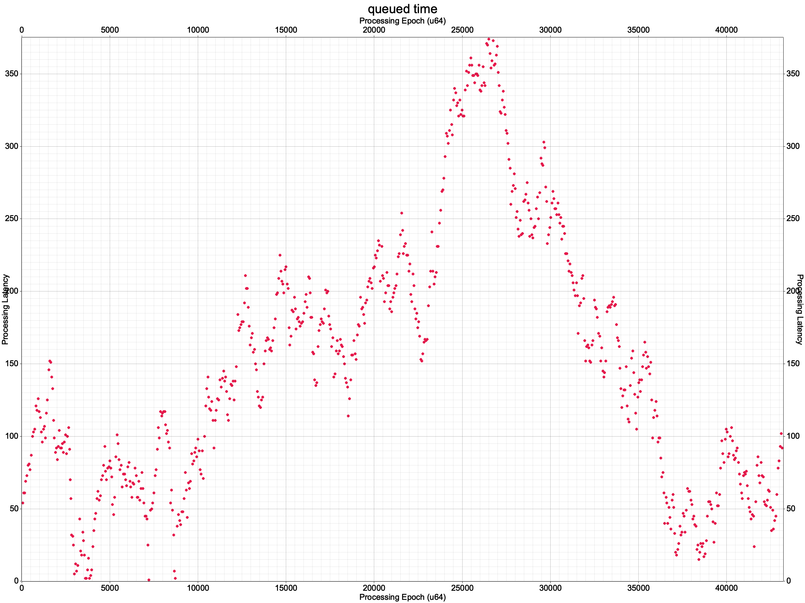

`simul` is a discrete-event simulation library for running high-level
simulations of real-world problems and for running simulated experiments.

`simul` is a *discrete-event simulator* using *incremental time progression*,
with [M/M/c queues](https://en.wikipedia.org/wiki/M/M/c_queue) for interactions
between agents. It also supports deterministic typed experiments and seeded
searches over caller-defined candidate spaces.

Use-cases:
- [Discrete-event simulation](https://en.wikipedia.org/wiki/Discrete-event_simulation)
- [Complex adaptive systems](https://authors.library.caltech.edu/60491/1/MGM%20113.pdf)
- [Random search](https://en.wikipedia.org/wiki/Random_search)
- [Job-shop scheduling](https://en.wikipedia.org/wiki/Job-shop_scheduling)
- [Birth-death processes](https://en.wikipedia.org/wiki/Birth%E2%80%93death_process)
- [Computer experiments](https://en.wikipedia.org/wiki/Computer_experiment)
- Other: simulating logistics, operations research problems, running experiments
  to approximate a global optimum, simulating queueing systems, distributed
  systems, performance engineering/analysis, and so on.

# Usage

> **Warning**
>
> Experimental and unstable. Almost all APIs are expected to change.

- For some examples, see the `examples` subdirectory.
- For use cases where your agents need their own custom state, define a struct,
  implement `Agent`, and pass your agents into `Simulation` via constructing
  `AgentInitializers`.

## Typed experiments (source checkout)

`experiment` is independent of the agent engine. The consolidated API below is
available in this checkout; it has not been published as a new crates.io release.

- Schedule explicit `TrialSpec` values with `CandidateId` and `ReplicationId`.
  `run_serial_bounded` rejects duplicate identities and oversized batches before
  evaluation, and returns records ordered by `TrialId`.
  Batch independent candidates in one runner call. Pass `&candidate` to
  `FixedReplications::trials` to share large inputs without cloning their contents.
- Replay uses the unchanged V1 keyed BLAKE3/ChaCha12 protocol. Retain `ReplayKey`,
  candidate inputs, and evaluator configuration. Named common-random streams
  share noise across candidates; `ValidationHoldout` separates validation noise.
- With `parallel`, `run_parallel` uses a dedicated bounded Rayon pool and one
  mutable workspace per contiguous shard. Its factory is
  `FnMut() -> Result<W, WE>`, called on the caller thread. Explicit batch/output
  storage and the pool are prepared before factories, and every factory succeeds
  before evaluation starts. Requested workers are capped by work and available
  parallelism. Evaluators must use only their inputs, context, immutable
  configuration, and unobservable scratch for worker-count-independent results.
  Shards write directly into disjoint ranges of one final result allocation;
  initialization guards drop partial results on failure without a second buffer.
  For repeated batches, construct `ParallelExecutor::new(config)` once and call
  `executor.run(seed, trials, init_worker, evaluate)`. Worker capacity is fixed at
  construction; each batch initializes fresh workspaces on its caller thread.
  Empty batches invoke no callbacks, and failed batches do not invalidate the
  executor. Prefer serial execution when individual batches are very cheap.
- Setup failures are run-level errors; evaluator `Err` values remain ordered
  trial records. With unwinding enabled, callback panics discard partial output
  and return a run-level error without retries. This does not roll back callback
  side effects, and cannot catch panics in `panic = "abort"` builds.
- `aggregate_scalar` and `aggregate_bernoulli` apply explicit failure policies.
  Unrepresentable scalar arithmetic returns `ArithmeticOverflow`, never a
  successful non-finite summary.
- `search::SeededRandomSearch` provides tokenized ask/tell search.
  `CrossEntropyOptimizer` and `simulated_annealing_search_with_rng` remain
  engine-independent optimizer alternatives; aggregate noisy trials inside their
  objective rather than ranking a lucky single run.

The duplicate `experiment::replicated` API and its SplitMix64/Box–Muller replay
protocol are removed, not aliased. Old replay keys are not interchangeable with
V1 BLAKE3/ChaCha12 keys. The `TrialKey` alias is removed in favor of `TrialId`;
the simulation-coupled `monte_carlo_search` and `simulated_annealing_search`
wrappers are removed. See `examples/simple_experiment.rs` and
`benches/deterministic_search_benchmark.rs` for the typed replacement.

## Basic usage

``` toml
[dependencies]
simul = "0.5.1"
```

``` rust
use simul::agent::*;
use simul::Simulation;
use simul::SimulationParameters;

/// Example of a minimal, simple Simulation that can be executed.
fn main() {
    // Runs a simulation with a producer that produces work at every tick of
    // discrete time (period=1), and a consumer that cannot keep up (can only
    // process that work every third tick).
    let mut simulation = Simulation::new(SimulationParameters {
        // We pass in two agents:
        //   `producer`: produces a message to the consumer every tick
        //   `consumer`: consumes w/ no side effects every second tick
        // Agents are powerful, and you can pass-in custom implementations here.
        agent_initializers: vec![
            periodic_producer("producer", 1, "consumer"),
            periodic_consumer("consumer", 2),
        ],

        // We pass in a halt condition so the simulation knows when it is finished.
        // In this case, it is "when the simulation is 10 ticks old, we're done."
        halt_check: |s: &Simulation| s.time() == 10,

        ..Default::default()
    });

    // For massive simulations, you might block on this line for a long time.
    simulation.run();

    // Post-simulation, you can do analytics on the stored metrics, data, etc.
    simulation
        .agents()
        .iter()
        .for_each(|agent| println!("{agent:#?}"));
}
```

## Simulation Concepts / Abstraction

- A simulation is a collection of `Agents` that interact with each other via
`Messages`.
- The simulation keeps a discrete time (u64) which is incremented on each tick
  of the Simulation.
- What an `Agent` does at each tick of the simulation is provided by you in its
  `on_tick()` and `on_message()` methods.
- `Agents` must have a unique name. Each also has a dense `AgentId`: its
  position in `agent_initializers`.
- If an `Agent` wants to interact with another `Agent`, it can send a `Message`
  via the `&mut ctx: AgentContext` passed into `on_tick` and `on_message`.
  `ctx.send(name, payload)` resolves a name; `ctx.send_to(id, payload)` skips
  the lookup, and `ctx.agent_id(name)` resolves a peer once for reuse.

The simulation runs all the logic of calling `process()`, distributing messages,
tracking metrics, incrementing time, and when to halt. A `Simulation` is
finished when the provided `halt_check` function returns `true`, or after the
tick in which an `Agent` calls `ctx.send_halt_interrupt(reason)`.

Messages identify agents by `AgentId`: `source` is the sender (absent for an
initial queue entry) and `destination` the addressed agent (absent when the
target matched no agent, in which case the message is recorded but not
delivered). `Simulation::agent(id)` and `Simulation::agent_id(name)` translate
between identities and agents. Create initial messages with `Message::new` or
`Message::new_with_payload`, not struct literals.

Payloads are `Option<Arc<[u8]>>`. Building one allocates once, for example
`Some(Arc::from([tag, value]))`; clones, histories, and forwarded payloads such
as `ctx.send(next, message.custom_payload.clone())` share the bytes. Edit a
payload with `Arc::make_mut`, which copies it only while shared. A message
without a payload allocates nothing, and clones keep independent timestamps and
identities.

Simulations with more than 64 agents and neither per-tick metric use an ordered
ready bitmap and wake heap during sparse phases, switching to dense scans as
activity rises. Smaller simulations and runs with queue-depth or asleep-cycle
metrics keep dense scans. Callback order, end-of-tick delivery, and halt checks
on every tick are unchanged; the scheduler never jumps over quiet ticks.

## Poisson-distributed example w/ Plotting

Here's an example of an outputted graph from a simulation run. In this
simulation, we show the average waiting time of customers in a line at a
cafe. The customers arrive at a Poisson-distributed arrival rate
(`lambda<-60.0`) and a Poisson-distributed coffee-serving rate with the
same distribution.

This simulation maps to the real world by assuming one tick of
discrete-simulation time is equal to one second.

Basically, the barista serves coffees at around 60 seconds per drink and
the customers arrive at about the same rate, both modeled by a
stochastic Poisson generator.

This simulation has a `halt_check` condition of the simulation's time
being equal to `60*60*12`, representing a full 12-hour day of the cafe
being open.



# Contributing

Issues, bugs, features are tracked in TODO.org
