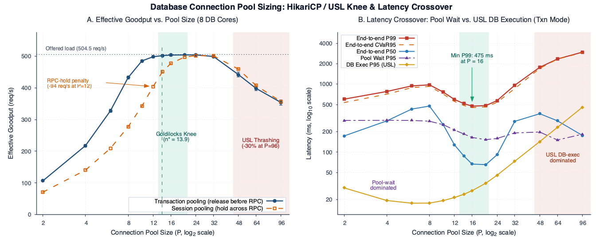
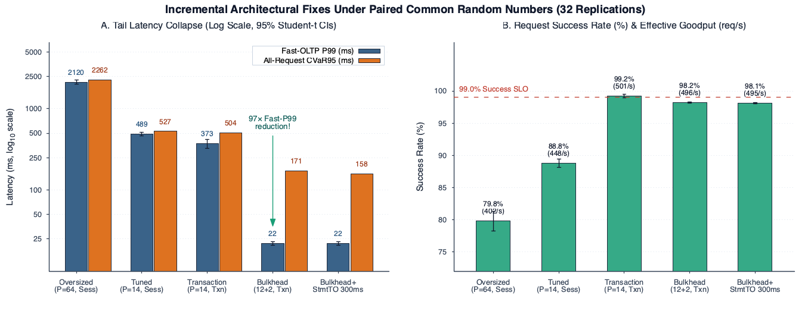
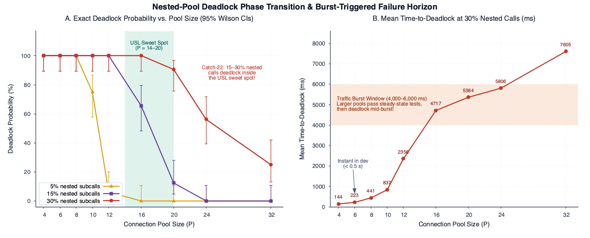
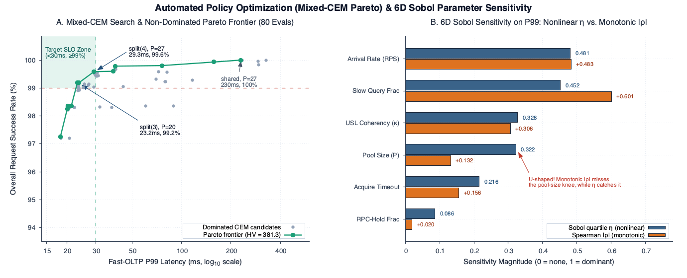

# Database Connection Pool Sizing & Nested-Pool Deadlock

A discrete-event simulation answering a classic production systems question:

> **Why do oversized database connection pools make latency *worse*, how much do hold-across-RPC bugs and slow queries actually cost, and where is the exact phase cliff where nested connection acquisitions deadlock?**

Closed-form averages and static spreadsheets routinely mis-size connection pools because real pools are governed by **nonlinear feedback loops**: Universal Scalability Law (USL) database contention, slow-query head-of-line (HOL) blocking, idle connection hoarding across external RPCs, burst-triggered metastable collapse, and probabilistic nested-pool lockups.

---

## Executive Summary of Key Findings & Thresholds

Evaluated on an **8-core primary database** (`sigma = 0.25`, `kappa = 0.25`, analytical USL peak $n^* = 13.9$) under **440 req/s steady load** with a **2-second `1.55×` traffic burst** (`682 req/s`, average offered load `504.5 req/s`), 4% slow analytical queries (`140 ms` base, lognormal tail), and 20% external RPC calls (`55 ms` mean) across **32 Common Random Numbers (CRN) replications**:

| Limiting Factor | Quantitative Threshold / Result | Actionable Takeaway |
| :--- | :--- | :--- |
| **1. HikariCP / USL Knee** | Peak goodput **`503.8 req/s`** and minimum P99 **`474.7 ms`** occur at **`P = 14–20`** (`~1.75–2.5× DB cores`). Oversizing to **`P = 64–96`** triggers USL collapse: DB execution P95 jumps **`17×`** (`27 → 458 ms`), P99 spikes **`6.2×`** (`475 → 2,958 ms`), and goodput drops **`-30%`** (`503 → 354 req/s`). | Size the pool to protect the DB (`~1.5–2.5× DB cores`), never to match app thread count. |
| **2. Hold-Across-RPC Starvation** | At `P = 12–14`, holding connections idle across 55 ms RPCs (`Session` mode) costs **`-50 to -94 req/s`** goodput and drops success rate from **`99.2%` to `88.8%`**. Releasing before RPC (`Transaction` mode) adds **`+52.8 req/s`** and cuts Fast-OLTP P99 by **`-115.4 ms`** (`95% CI [-151.4, -79.5]`). | Never perform network I/O inside an open DB transaction or session-bound connection. |
| **3. Slow-Query HOL Blocking & Bulkheads** | Moving from a shared `P = 14` pool to a **`12 + 2` fast/slow bulkhead** cuts Fast-OLTP P99 from **`373.4 ms` → `21.9 ms`** (**`17×` faster** vs. shared, **`97×` faster** vs. oversized `P = 64`!), and cuts overall `CVaR95` from `504.3` to `171.2 ms`. Adding a DB **`statement_timeout = 300 ms`** trims `CVaR95` another **`-12.8 ms`** (`[-14.1, -11.5]`) at just `0.21%` abort rate. | Quarantine slow analytical/batch queries into a small dedicated sub-pool (`2–4` conns) and enforce a DB `statement_timeout`. |
| **4. Nested-Pool Deadlock Catch-22** | Exact deadlock exhibits a **razor-sharp phase cliff**: at `5%` nested subcalls, deadlock drops `100% → 75% → 6.2% → 0%` across `P = 8 → 10 → 12 → 16`. At `15%–30%`, deadlock strikes **inside the USL sweet spot (`65.6%–100%` at `P = 16`)** and remains **`25%` even at `P = 32`**, hiding until the traffic burst (`4.7–5.8 s` TTD). | You **cannot** size your way out of nested acquisition deadlock—eliminate nested borrows or route nested subcalls to a separate pool. |
| **5. Nonlinear Sensitivity & Automated Pareto Tuning** | **6D Sobol screening** reveals why naive monotonic sensitivity fails: `Pool Size (P)` has low Spearman `ρ = +0.132` (U-curve cancellation), while quartile **`η = 0.322`** catches it immediately. **Mixed-CEM + Pareto** autonomously discovers the `split(3..4)` knee (**`23.2–29.3 ms` Fast-P99 at `99.2%–99.6%` success**). | Always evaluate pool sizing with non-monotonic sweeps or multi-objective optimization (`Fast-P99` vs. `Success Rate`). |

---

## Model Architecture & Physics

One discrete tick equals **1 millisecond** (`1 tick = 1 ms`). Five `simul` agents run under strict routing (`UnknownDestinationPolicy::Panic`) and burst-draining (`drain_all_messages()`):

| Agent | Mode | Responsibility |
| :--- | :--- | :--- |
| `load_gen` | Proactive | Draws exact Poisson arrivals per ms (with a `1.55×` burst window at `4,000–6,000 ms`) and pre-samples synchronized per-request lognormal complexity & RPC latency so every compared architecture sees identical demand (high-precision CRN). |
| `app` | Reactive | Bounded application thread pool (`app_workers = 96+`) driving multi-stage request lifecycles (`Fast`, `Slow`, `RpcHold`, `Nested`) and measuring post-warmup (`2,000–9,500 ms`) latency quantiles, `CVaR95`, and goodput. |
| `pool` | Reactive | Single shared or fast/slow bulkhead FIFO pool with **cancellable `acquire_timeout` timers** (`send_after` + `cancel_timer` on grant) and exact nested-pool deadlock detection (`in_use == capacity && nested_waiters >= capacity`). |
| `db` | Reactive | Primary database executing concurrent queries under Gunther's USL contention/coherency slowdown and optional **cancellable `statement_timeout` timers** (cancelling normal completion when a runaway query is aborted). |
| `rpc` | Reactive | External downstream HTTP/gRPC dependency delaying replies by the request's RPC duration. |

### Universal Scalability Law (USL) Contention Model

With $c = \text{db\_cores}$ physical CPU cores and $n$ concurrently executing queries inside `db`, each query's execution time scales by:

$$f(n) = 1 + \sigma \cdot \max\!\left(0, \frac{n - c}{c}\right) + \kappa \cdot \frac{n(n - 1)}{c^2}$$

- For $n \le c$, queries run without CPU oversubscription and pay only light shared-buffer/WAL coherency ($\kappa$).
- For $n > c$, linear context-switch/scheduler contention ($\sigma$) and quadratic cache-line/lock-table coherency ($\kappa$) cause throughput $C(n) = \frac{n}{\bar{S}_0 \cdot f(n)}$ to peak at the analytical USL knee:

$$n^* = c \sqrt{\frac{1 - \sigma}{\kappa}}$$

For the default hardware (`c = 8`, `sigma = 0.25`, `kappa = 0.25`), $n^* = 8 \sqrt{0.75 / 0.25} \approx \mathbf{13.9}$ active queries—matching HikariCP's empirical `~1.5–2× cores` sizing law. Beyond $n^*$, admitting more queries into the database creates a **metastable feedback loop**: slower queries hold connections longer $\rightarrow$ more concurrent queries accumulate $\rightarrow$ $f(n)$ rises further $\rightarrow$ effective capacity falls below steady offered load.

---

## Experimental Results & Analysis

All tables and graphs below were generated directly from:

```bash
cargo run --release --all-features --example connection_pool -- \
    --reps 32 --export-data /tmp/pool_data
gnuplot -e "DATA_DIR='/tmp/pool_data'; OUT_DIR='examples/connection_pool/assets'" \
    examples/connection_pool/plot.gp
```

### 1. Pool-Size Sweep & HikariCP / USL Throughput Knee



*Default workload (`440 req/s` steady, `1.55×` burst `4–6 s`, average offered load `504.5 req/s`, `4%` slow queries, `20%` RPC-hold, `8 DB cores`, `32 CRN reps/point`):*

| Pool (`P`) | Txn Goodput (req/s) | Succ % | P50 (ms) | P99 (ms) | CVaR95 (ms) | Pool Wait P95 | DB Exec P95 | Sess Goodput (req/s) | Limiting Regime |
|---:|---:|---:|---:|---:|---:|---:|---:|---:|:---|
| 2 | 106.9 ± 3 | 21.2% | 173.2 | 602.2 | 536.0 | 292.8 | 29.8 | 71.1 | Pool-starved (wait) |
| 4 | 217.8 ± 4 | 43.2% | 288.4 | 780.7 | 712.2 | 294.0 | 19.4 | 140.7 | Pool-starved (wait) |
| 6 | 327.7 ± 5 | 64.9% | 430.2 | 943.1 | 888.7 | 293.0 | 17.7 | 209.4 | Pool-starved (wait) |
| 8 | 432.4 ± 5 | 85.7% | 476.4 | 977.3 | 927.1 | 285.2 | 17.8 | 277.4 | Pool-starved (wait) |
| 10 | 484.7 ± 4 | 96.0% | 253.5 | 765.3 | 715.7 | 253.6 | 19.4 | 342.2 | Pool-starved (wait) |
| 12 | 498.0 ± 4 | 98.6% | 128.3 | 596.3 | 557.2 | 212.2 | 21.5 | 403.9 | Queue-limited |
| **14** | **501.4 ± 3** | **99.3%** | **87.6** | **517.6** | **486.1** | **184.8** | **24.0** | 451.1 | **Goldilocks knee** |
| **16** | **503.2 ± 3** | **99.7%** | **66.7** | **474.7** | **451.6** | **164.6** | **27.1** | 476.7 | **Goldilocks knee** |
| **20** | **503.7 ± 3** | **99.8%** | **65.5** | **483.8** | **463.1** | **152.6** | **34.9** | 496.9 | **Goldilocks knee** |
| 24 | 503.8 ± 3 | 99.8% | 91.4 | 573.4 | 540.3 | 159.1 | 45.7 | 501.3 | USL contention-bound |
| 32 | 498.7 ± 4 | 98.8% | 284.0 | 964.8 | 861.3 | 191.5 | 73.5 | 501.0 | USL contention-bound |
| 48 | 441.6 ± 7 | 87.5% | 367.4 | 1770.6 | 1705.6 | 197.7 | 142.9 | 458.7 | USL thrashing cliff |
| 64 | 398.0 ± 7 | 78.9% | 289.2 | 2346.0 | 2336.9 | 151.0 | 231.2 | 407.1 | USL thrashing cliff |
| 96 | 353.6 ± 8 | 70.1% | 176.2 | 2958.2 | 2907.9 | 183.4 | 457.9 | 356.5 | USL thrashing cliff |

**Why the latency curve is U-shaped:** Panel B exposes the physical crossover directly. Below `P = 14`, **Pool Wait P95** (`250–294 ms`) dominates while the database sits lightly loaded (`DB Exec P95 ≈ 18–21 ms`). Above `P = 24`, the pool stops acting as an admission-control valve: **DB Exec P95** explodes exponentially from `27 ms` (`P = 16`) to `458 ms` (`P = 96`), trapping the database in retrograde USL thrashing even after the burst ends.

---

### 2. Paired CRN Comparison of Five Production Architectures



Comparing five progressive architectural fixes on identical CRN arrival streams (`32 replications`, 95% Student-$t$ confidence intervals):

| Architecture | Goodput (req/s) | Succ % | Fast-OLTP P99 (ms) | All P99 (ms) | CVaR95 (ms) | StmtTO % |
|:---|---:|---:|---:|---:|---:|---:|
| 1. Oversized (`P=64`, Session) | 402.5 ± 6.5 | 79.8% | 2120.0 ± 126.1 | 2239.0 | 2262.1 | 0.00% |
| 2. Tuned Pool (`P=14`, Session) | 448.1 ± 2.6 | 88.8% | 488.9 ± 28.1 | 550.3 | 526.8 | 0.00% |
| 3. Transaction Pool (`P=14`, Txn) | **500.9 ± 3.4** | **99.2%** | 373.4 ± 49.3 | 538.5 | 504.3 | 0.00% |
| 4. Bulkhead (`12+2`, Txn) | 495.8 ± 3.1 | 98.2% | **21.9 ± 1.0** | 244.3 | 171.2 | 0.00% |
| 5. Bulkhead+StmtTO (`12+2`, 300ms) | 495.2 ± 3.2 | 98.1% | **21.9 ± 1.0** | **230.0** | **158.4** | 0.21% |

**Paired CRN incremental deltas (`compare_paired_candidates`, challenger − baseline):**

| Incremental Upgrade | Δ Fast-OLTP P99 [95% CI] | Δ CVaR95 [95% CI] | CVaR VRR | Δ Goodput |
|:---|---:|---:|---:|---:|
| Oversized → Tuned Pool | **−1631.1 ms** `[−1737.4, −1524.8]` | **−1735.3 ms** `[−1838.3, −1632.3]` | 1.5× | **+45.6/s** |
| Session → Transaction | **−115.4 ms** `[−151.4, −79.5]` | −22.5 ms `[−56.7, +11.6]` | 2.5× | **+52.8/s** |
| Shared → Bulkhead (`12+2`) | **−351.5 ms** `[−400.9, −302.2]` | **−333.1 ms** `[−379.4, −286.8]` | 1.0× | −5.1/s |
| Bulkhead → +StmtTO (300ms) | +0.0 ms `[−0.1, +0.1]` | **−12.8 ms** `[−14.1, −11.5]` | **3.5×** | −0.6/s |

Each fix removes a distinct bottleneck: right-sizing eliminates USL thrashing (`−1,631 ms`), transaction pooling reclaims idle RPC slots (`+52.8 req/s`, `88.8% → 99.2%` success), fast/slow bulkheading removes slow-query HOL blocking (**`17×` faster OLTP P99**, `373 → 21.9 ms`), and `statement_timeout` cleanly caps heavy-tail analytical outliers (`3.5×` CRN variance reduction on `CVaR95`).

---

### 3. Nested-Pool Deadlock Phase Boundary & Forensic Perfetto Replay



When an outer request holds connection #1 and tries to borrow a second connection from the **same** pool, FIFO queueing creates a self-reinforcing ratchet: each queued nested request permanently locks one slot until free slots hit zero (`in_use == capacity && nested_waiters == capacity`).

| Pool (`P`) | `nested = 5%` (95% Wilson CI) | `nested = 15%` (95% Wilson CI) | `nested = 30%` (95% Wilson CI) | Mean TTD @ 30% |
|---:|---:|---:|---:|---:|
| 4 | 100.0% `[89.3%, 100.0%]` | 100.0% `[89.3%, 100.0%]` | 100.0% `[89.3%, 100.0%]` | 144 ms |
| 6 | 100.0% `[89.3%, 100.0%]` | 100.0% `[89.3%, 100.0%]` | 100.0% `[89.3%, 100.0%]` | 223 ms |
| 8 | 100.0% `[89.3%, 100.0%]` | 100.0% `[89.3%, 100.0%]` | 100.0% `[89.3%, 100.0%]` | 441 ms |
| 10 | **75.0%** `[57.9%, 86.7%]` | 100.0% `[89.3%, 100.0%]` | 100.0% `[89.3%, 100.0%]` | 837 ms |
| 12 | **6.2%** `[1.7%, 20.1%]` | 100.0% `[89.3%, 100.0%]` | 100.0% `[89.3%, 100.0%]` | 2,356 ms |
| 16 | 0.0% `[0.0%, 10.7%]` | **65.6%** `[48.3%, 79.6%]` | 100.0% `[89.3%, 100.0%]` | 4,717 ms |
| 20 | 0.0% `[0.0%, 10.7%]` | **12.5%** `[5.0%, 28.1%]` | **90.6%** `[75.8%, 96.8%]` | 5,364 ms |
| 24 | 0.0% `[0.0%, 10.7%]` | 0.0% `[0.0%, 10.7%]` | **56.2%** `[39.3%, 71.8%]` | 5,806 ms |
| 32 | 0.0% `[0.0%, 10.7%]` | 0.0% `[0.0%, 10.7%]` | **25.0%** `[13.3%, 42.1%]` | 7,605 ms |

**Two insidious production traps shown in Chart 3:**
1. **The USL vs. Deadlock Catch-22 (Panel A):** USL contention demands a small pool (`P = 14–20`), yet `15%–30%` nested calls deadlock `66%–100%` of the time right inside that sweet spot. Expanding to `P = 32` *still* deadlocks 25% of the time while already doubling P99 latency to `965 ms` from USL contention!
2. **Burst-Triggered Latent Deadlock (Panel B):** Small dev pools (`P = 4–8`) fail within `< 0.5 s`, so bugs surface quickly in local tests. At `P = 16–24`, steady-state traffic passes cleanly—only to deadlock **`4,717–5,806 ms`** into the run, right inside the `4,000–6,000 ms` traffic burst!

#### Two-Pass Windowed Forensic Replay

Using `simul::trace::forensic_replay_trial_with_payloads`, the simulator fast-forwards the deadlocked replication (`pool_size = 8`, `nested = 15%`) untraced to `t = 645 ms` and enables full payload tracing strictly over the final `80 ms` before lockup:

```text
Two-pass forensic replay (pool_size=8, nested=15%, deadlock @ t=725ms):
  Window 645..726ms -> 466 trace events (170 sent, 15 timers cancelled, 1 halt), 98361 bytes Perfetto JSON
    t=678ms AcquireConn { req_id: 209, lane: Fast, is_nested: true }
    t=722ms AcquireConn { req_id: 219, lane: Fast, is_nested: true }
    t=724ms AcquireConn { req_id: 218, lane: Fast, is_nested: true }
    t=725ms HALT(nested_pool_deadlock)
```

Export the causal swimlane trace and open it in [Perfetto UI](https://ui.perfetto.dev):

```bash
SIMUL_PERFETTO_OUT=/tmp/deadlock_trace.json \
  cargo run --release --all-features --example connection_pool -- --scenario deadlock
```

---

### 4. Mixed-Variable CEM Pareto Frontier & 6D Sobol Global Sensitivity



#### Automated Policy Discovery (`MixedCrossEntropyOptimizer` + `ParetoArchive`)

Searching jointly across 5 mixed dimensions (`pooling ∈ {Session, Transaction}`, `bulkhead ∈ {Shared, Split}`, `pool_size ∈ [6, 48]`, `slow_cap ∈ [1, 6]`, `acquire_timeout ∈ [40, 350] ms`; 80 candidates × 8 CRN reps; 2D dominated hypervolume `381.3` vs. reference `(400 ms, 0%)`):

| CID | Pooling | Bulkhead | Pool (`P`) | Acquire TO (ms) | Fast-OLTP P99 (ms) | Success % | Goodput (req/s) |
|---:|:---|:---|---:|---:|---:|---:|---:|
| 64 | transaction | `split(1)` | 30 | 169 | 18.3 | 97.25% | 486.5 |
| 36 | transaction | `split(2)` | 18 | 189 | 20.4 | 98.35% | 492.0 |
| **70** | **transaction** | **`split(3)`** | **20** | **334** | **23.2** | **99.19%** | **496.2** |
| **33** | **transaction** | **`split(4)`** | **27** | **343** | **29.3** | **99.59%** | **498.2** |
| 10 | transaction | `split(5)` | 20 | 324 | 39.4 | 99.78% | 499.1 |
| 19 | session | `split(6)` | 29 | 218 | 75.9 | 99.80% | 499.2 |
| 13 | session | `shared` | 27 | 271 | 230.1 | 100.00% | 500.2 |

**The Pareto knee (`split(3)` to `split(4)`):** Compared to a shared pool (`230.1 ms` Fast-P99, `100.0%` success), quarantining slow queries to `3–4` connections with a generous slow-lane `acquire_timeout` (`~334 ms`) achieves **`23.2–29.3 ms` Fast-OLTP P99** (**`8–10×` faster**) while preserving **`99.2%–99.6%` overall success**!

#### 6D Sobol Global Sensitivity Screening (`sample_sobol`, 64 points × 8 CRN reps)

| Rank | Parameter | Range | Nonlinear `η(P99)` | Spearman `ρ(P99)` | `ρ(Fast-P99)` | `ρ(Timeout)` |
|---:|:---|:---|---:|---:|---:|---:|
| 1 | Arrival Rate (RPS) | `[250, 620]` | **0.481** | +0.483 | +0.510 | +0.202 |
| 2 | Slow Query Frac | `[0%, 12%]` | **0.452** | **+0.601** | +0.472 | **+0.571** |
| 3 | USL Coherency (`κ`) | `[0.05, 0.50]` | **0.328** | +0.306 | +0.303 | +0.386 |
| 4 | **Pool Size (`P`)** | `[6, 64]` | **0.322** | **+0.132** *(U-curve!)* | +0.013 | −0.269 |
| 5 | Acquire Timeout | `[40, 350] ms` | 0.216 | +0.156 | +0.283 | −0.458 |
| 6 | RPC-Hold Frac | `[0%, 40%]` | 0.086 | +0.020 | +0.004 | +0.129 |

**Methodological insight:** Because `P99(pool_size)` is strongly **U-shaped**, its monotonic Spearman rank correlation (`ρ = +0.132`, `ρ(Fast-P99) = +0.013`) cancels left-side starvation against right-side USL thrashing. Pairing Spearman `ρ` with the dyadic 4-quartile Sobol correlation ratio **`η = 0.322`** immediately recovers `pool_size` as a Tier-1 driver alongside load, slow queries, and lock coherency. Meanwhile, `acquire_timeout` exposes the classic reliability/tail trade-off (`ρ(Timeout) = −0.458`, `ρ(Fast-P99) = +0.283`).

---

## Production Pool Sizing Playbook

1. **Start at `pool_size ≈ 1.5–2× DB CPU cores`, never `app_workers`.** Treat the pool as an admission-control bulkhead protecting the primary DB from crossing its USL peak $n^* = c\sqrt{(1-\sigma)/\kappa}$. Wait in RAM at the app tier rather than thrashing locks inside the DB.
2. **Enforce transaction-scoped checkout (zero network I/O while holding a connection).** Releasing before external RPCs recovers `+50–94 req/s` of effective capacity without enlarging the pool into USL territory.
3. **Split OLTP and analytical/batch traffic into separate pools.** Even `4%` slow queries in a shared pool inflate Fast-OLTP P99 by **`17×`**. A dedicated slow lane sized via Little's Law (`slow_cap ≈ λ_slow · S_slow ≈ 3–4`) delivers `<30 ms` Fast-OLTP P99 at `>99.2%` overall success.
4. **Always pair a pool `acquire_timeout` with a DB-side `statement_timeout`.** Pool timeouts protect callers from waiting forever; `statement_timeout` reclaims DB CPU slots from heavy-tail runaway queries and bounds `CVaR95`.
5. **Forbid nested connection acquisition on the same pool.** Pass the active connection/transaction handle downward or dedicate a separate pool for nested subcalls. Sizing upward to avoid deadlock pushes the pool directly into USL thrashing and merely delays deadlock until a production traffic burst hits.

---

## Running & Customizing the Simulation

```bash
# Run unit tests verifying all 4 core physical invariants
cargo test --example connection_pool --all-features

# Quick smoke run (~1s)
cargo run --release --all-features --example connection_pool -- --quick

# Full 32-replication study + TSV export + gnuplot regeneration
cargo run --release --all-features --example connection_pool -- \
    --reps 32 --export-data /tmp/pool_data
gnuplot -e "DATA_DIR='/tmp/pool_data'; OUT_DIR='examples/connection_pool/assets'" \
    examples/connection_pool/plot.gp

# Explore custom hardware / workload regimes (e.g., 16-core DB, heavier slow queries)
cargo run --release --all-features --example connection_pool -- \
    --scenario sweep --db-cores 16 --rps 850 --slow-frac 0.08 --reps 24

# See all adjustable parameters
cargo run --release --all-features --example connection_pool -- --help
```

### Adjustable CLI Parameters

| Group | Flags | Defaults |
|:---|:---|:---|
| **Scenario & Output** | `--scenario {all,sweep,patterns,deadlock,optimize,sensitivity}`, `--reps`, `--seed`, `--quick`, `--export-data <DIR>` | `all`, `24`, `20260505` |
| **DB Hardware (USL)** | `--db-cores`, `--usl-sigma`, `--usl-kappa`, `--statement-timeout-ms` | `8`, `0.25`, `0.25`, `0` (off) |
| **Workload & Burst** | `--rps`, `--burst-mult`, `--fast-ms`, `--slow-ms`, `--slow-frac`, `--rpc-hold-frac`, `--rpc-ms`, `--nested-frac`, `--horizon-ms`, `--warmup-ms` | `440`, `1.55`, `6`, `140`, `0.04`, `0.20`, `55`, `0.0`, `10000`, `2000` |
| **Pool & App Server** | `--app-workers`, `--pool-size`, `--acquire-timeout-ms` | `96`, `14`, `150` |
| **Forensic Trace** | `SIMUL_PERFETTO_OUT=<path>` (environment variable) | unset |
